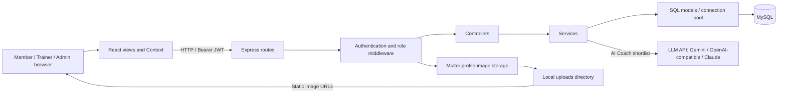
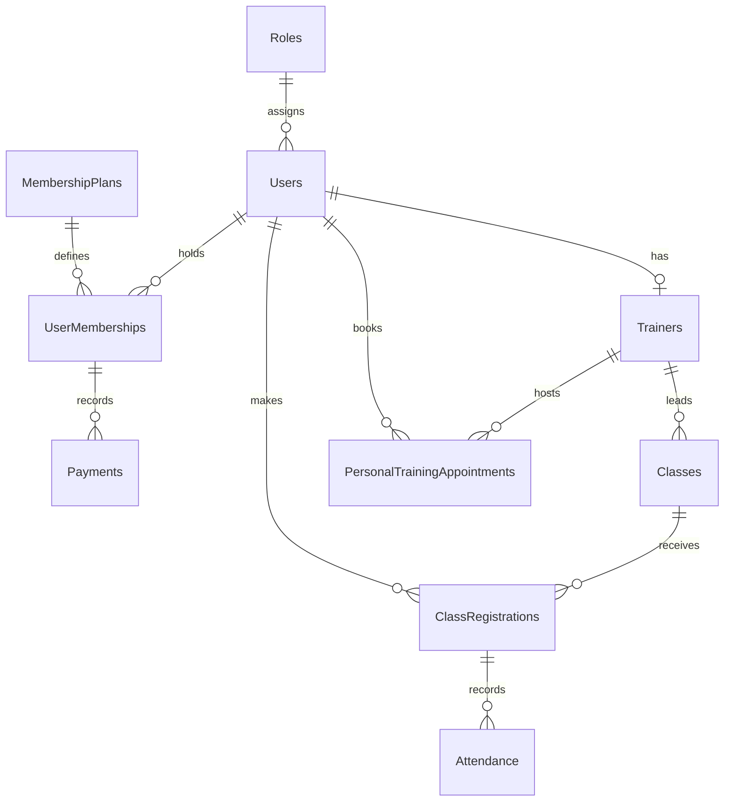

# The Muscle Lab

A full-stack gym management application for member self-service, class scheduling, and day-to-day administration.

**Members** manage their profiles, memberships, and class registrations, and get class suggestions from an LLM-backed coach. **Trainers** record attendance for their classes. **Admins** manage trainers and classes and track gym activity. Built with **React, Express, and MySQL**, with JWT authentication and role-protected APIs.

**Engineering highlights:** transaction-safe class booking, membership enrollment, and attendance · server-side LLM integration with validated output and a rule-based fallback · 10-table relational schema · JWT/RBAC · unit, MySQL integration, and browser tests.

[Deployment guide](docs/DEPLOYMENT.md)

[Features](#features) · [Local setup](#local-setup) · [Architecture](#architecture) · [API](#api-overview) · [Testing](#testing) · [Screenshots](#screenshots)

## Features

| Role | Implemented workflows |
| --- | --- |
| Member | Register and sign in; edit profile and photo; change password; enroll in/cancel a membership; register for/cancel classes; view dashboard and monthly calendar; get an AI Coach class suggestion and register for it in one click. |
| Trainer | Record who attended each of their own classes, once the class has started. |
| Admin | View users and membership plans; create, edit, and delete trainer profiles and classes; record attendance for any class; review membership, booking, growth, and attendance metrics. Additional APIs support user deletion, plan CRUD, and class participant lookup. |

### AI Coach

The coach runs on the server. It reads the member's last classes, bookings, and membership from the database, ranks the open classes in the next two weeks (favourite class types, trainers, days, and times; no clashes with existing bookings), and sends a shortlist of up to eight to an LLM, which picks one and explains why. The default provider is Gemini; any OpenAI-compatible API or Claude can be configured.

- The model only chooses among listed options (`c1`…`c8`). Replies are parsed and validated, and class details always come from the database, so a model can't invent a class or a time.
- Without an API key, or if the model call fails or returns an invalid reply, the coach falls back to the rule-based ranking and says so in the card.
- The API key stays on the server. The prompt contains the member's first name and class history only, no email or IDs.
- Suggestions are cached for 10 minutes per member, and the endpoint allows 6 requests per member per minute.

## Screenshots

Real application screenshots, cropped for focus and privacy. Click an image to view it at full size.

**Admin dashboard** — User, membership, class, and registration counts with participation indicators.

[](docs/screenshots/admin-dashboard.png)

| Member class registration | Membership overview |
| --- | --- |
| [](docs/screenshots/member-class-registration.png) | [](docs/screenshots/member-membership.png) |
| Browse schedules and available places; see which classes are already registered. | Review the current plan, remaining days, and membership cancellation action. |

<details>
<summary>Explore the class calendar and Admin trainer form</summary>

**Class calendar** — A monthly grid with class counts for each scheduled day.

[](docs/screenshots/member-calendar.png)

**Trainer management** — Create a trainer profile by selecting a user and entering specialization, experience, and biography.

[](docs/screenshots/trainer-management.png)

</details>

## Tech stack

Versions are the ranges declared in the package manifests; `npm ci` installs the exact lockfile versions.

| Layer | Technologies |
| --- | --- |
| Frontend | React / React DOM `^19.2.7`, React Router DOM `^7.18.1`, Vite `^8.1.1`, React Context, custom CSS, Lucide and React Icons |
| Backend | Node.js, Express `^5.2.1`, mysql2 `^3.23.1`, dotenv `^17.4.2`, CORS `^2.8.6` |
| Database | MySQL; 10 relational tables with UUID identifiers and foreign keys |
| Authentication / uploads | jsonwebtoken `^9.0.3`, bcrypt `^6.0.0`, Multer `^2.2.0`, express-rate-limit `8.7.3`; Node's built-in UUID generator |
| Verification | Node test runner, Playwright, Oxlint |

## Architecture

React Router separates public, Member, Trainer, and Admin views. React Context holds the shared user profile; fetch services communicate with the API. The backend uses routes, authentication/role middleware, controllers, services, and SQL models. Class services and the dashboard controller also query the connection pool directly.



```text
client/
├── src/components/     # Reusable UI, route guards, AI Coach
├── src/context/        # Shared user state
├── src/pages/          # Public, Member, Admin, and class views
├── src/routes/         # Client route definitions
├── src/services/       # API, authentication, and coaching helpers
├── test/               # Service regression tests
└── e2e/                # Browser workflow tests
server/
├── routes/             # Endpoint definitions and access requirements
├── middlewares/        # JWT verification, roles, uploads
├── controllers/        # HTTP handlers
├── services/           # Business rules and transactions
├── models/             # Parameterized SQL
├── config/             # MySQL connection pool
├── database/           # Schema and development seed
├── scripts/            # Safe database setup and local Admin creation
└── test/               # Security and opt-in HTTP integration tests
```

### Authentication and engineering decisions

- Passwords are bcrypt-hashed with 10 salt rounds. JWTs contain the user ID and role and expire after seven days.
- The client chooses localStorage or sessionStorage for login persistence. The API independently checks JWTs and Admin permissions; client route guards provide navigation restrictions.
- Class booking locks the class row inside a transaction before checking capacity. Membership enrollment locks the user row to prevent duplicate active enrollments under concurrent requests.
- Class cancellation changes registration status rather than deleting a row referenced by attendance records. Expired memberships are excluded from active-membership lookups.
- Authentication endpoints use per-IP throttling. Production requires an explicit `CORS_ORIGINS` allowlist; development defaults to loopback browser origins. Bearer headers are validated, and the Express signature header is disabled.
- Uploads use generated filenames, MIME-derived extensions, a 5 MiB limit, and JPEG/PNG/WebP MIME filtering. Files are public under `/uploads`; this is not content-signature validation.
- A single `VITE_API_URL` configures API requests and profile-image URLs. A local avatar fallback avoids sending user names to an external avatar service.
- Attendance saves lock the class row and its registrations in one transaction and update an existing record instead of adding a second one (`Attendance.class_registration_id` is unique). Trainers get the same 404 for another trainer's class as for a missing one, and attendance can't be recorded before a class starts.
- Dashboard rates are computed from real data: new members this month against last month, members with an active plan, and attendance only where staff recorded it. The eight queries run in parallel.
- Class times are local wall-clock times. Each database connection sets its session time zone from the server's `TZ`, so "has this class started" is correct on UTC hosts.

## Database design

[`schema.sql`](server/database/schema.sql) defines **10 tables**: `Roles`, `Users`, `Trainers`, `MembershipPlans`, `UserMemberships`, `Classes`, `ClassRegistrations`, `Attendance`, `PersonalTrainingAppointments`, and `Payments`.



A user can have one trainer profile; each user/class registration pair is unique. Attendance references are not unique in the schema. The seed includes Admin, Trainer, and Member roles, but the client has dedicated views only for Admin and Member. Payments and personal appointments are schema/seed entities, not implemented payment or booking workflows.

## API overview

All paths below start with `/api`. **Authenticated** means any valid JWT, not a Member-only role. Send `Authorization: Bearer <token>`.

| Method | Path | Access | Purpose |
| --- | --- | --- | --- |
| POST | `/auth/register`, `/auth/login` | Public | Create a Member account / sign in |
| GET | `/membership-plans`, `/membership-plans/:id` | Public | Browse plans |
| POST / PUT / DELETE | `/membership-plans`, `/membership-plans/:id` | Admin | Create / update / delete a plan |
| GET / PUT | `/users/profile` | Authenticated | Read / update own profile |
| PUT | `/users/profile/image`, `/users/change-password` | Authenticated | Upload multipart field `image` / change password |
| GET | `/users`, `/users/:id` | Admin | List / inspect users |
| DELETE | `/users/:id` | Admin | Delete an unreferenced user |
| GET | `/user-memberships/me` | Authenticated | Read own active membership |
| POST | `/user-memberships` | Authenticated | Enroll using `membership_plan_id` |
| PUT | `/user-memberships/cancel` | Authenticated | Cancel own membership |
| GET | `/classes`, `/classes/my` | Authenticated | Browse classes / own registrations |
| GET | `/classes/date-counts?start=YYYY-MM-DD&end=YYYY-MM-DD`, `/classes/by-date/:date` | Authenticated | Calendar counts / daily schedule |
| POST / DELETE | `/classes/:id/register` | Authenticated | Register / cancel registration |
| GET / POST | `/classes/admin` | Admin | List / create classes |
| PUT / DELETE | `/classes/admin/:id` | Admin | Update / delete a class |
| GET | `/classes/admin/:id/participants` | Admin | Inspect registrations |
| GET | `/trainers`, `/trainers/:id` | Authenticated | List / inspect trainers |
| POST / PUT / DELETE | `/trainers`, `/trainers/:id` | Admin | Create / update / delete a trainer profile |
| GET | `/dashboard/admin-overview` | Admin | Members, growth, active-plan and attendance rates, next classes, recent bookings |
| GET | `/coach/insight?refresh=1` | Member | AI Coach suggestion (`source` is `llm` or `rules`); `refresh` skips the cache |
| GET | `/attendance/classes?from=YYYY-MM-DD&to=YYYY-MM-DD` | Admin, Trainer | Classes with booking and attendance counts (trainers: own classes only) |
| GET / PUT | `/attendance/classes/:id` | Admin, Trainer | Roster with attendance / save `{ records: [{ registrationId, attended }] }` |
| GET | `/health` | Public | Health check for hosting platforms |

For grouped CRUD rows, POST uses the collection path; PUT and DELETE use `/:id`.

## Local setup

### 1. Prerequisites and install

- Node.js **24.22.2** (pinned in `.node-version`), and npm. The manifests also permit `^20.19.0` or `>=22.12.0`.
- A running MySQL server supporting expression defaults. Local setup has been verified with Node **20.20.2** and MySQL **9.6.0**.
- A MySQL account with permission to create a new local database during setup.

```bash
git clone https://github.com/estisellam/The-Muscle-Lab.git
cd The-Muscle-Lab
npm ci --prefix server
npm ci --prefix client
```

Root dependencies are not required to run either application.

### 2. Configure

```bash
cp server/.env.example server/.env
cp client/.env.example client/.env
```

If these files already exist, edit them instead of overwriting them. Set your MySQL credentials, a new database name, and a random JWT secret. Generate a secret with:

```bash
node -e "console.log(require('node:crypto').randomBytes(32).toString('hex'))"
```

| File | Variables |
| --- | --- |
| `server/.env` | `DB_HOST`, `DB_PORT`, `DB_USER`, `DB_PASSWORD`, `DB_NAME`, `PORT`, `JWT_SECRET` |
| `server/.env` | `CORS_ORIGINS`: comma-separated exact frontend origins; required with `NODE_ENV=production`. Blank in development allows localhost/loopback ports. |
| `client/.env` | `VITE_API_URL`: backend origin, normally `http://localhost:3000`, **without** `/api` |
| `server/.env` | `AI_PROVIDER` (`gemini`, `openai`, or `anthropic`), `AI_API_KEY`, optional `AI_MODEL`, `AI_BASE_URL` (OpenAI-compatible APIs), `AI_TIMEOUT_MS`. Leave `AI_API_KEY` blank for rule-based suggestions. |
| `server/.env` | `TZ`: the gym's time zone, for example `Asia/Jerusalem`. `DB_SSL=true` (and `DB_SSL_CA` if needed) for hosted databases. |

Environment files are ignored. Restart Vite after changing its variables. The model key is only read by the server; the browser never calls a model directly.

### 3. Initialize a new local database

```bash
npm run db:setup --prefix server
```

This creates `DB_NAME`, its 10 tables, and the development seed. It **refuses an existing database** and never drops one. If setup fails partway through, inspect that new database before choosing a different name and retrying.

The raw `server/database/schema.sql` starts with `DROP DATABASE`; do not run it against existing data. The safe setup command strips its database-selection/reset statements and uses the configured new database. Seed class dates are in August 2026; use the calendar's month controls or create future classes as an Admin.

### 4. Run both applications

In separate terminals, from the repository root:

```bash
npm run dev --prefix server
```

```bash
npm run dev --prefix client
```

The backend defaults to `http://localhost:3000`. Open the URL printed by Vite, normally `http://localhost:5173`. The backend creates its upload directory automatically. `npm start --prefix server` runs without nodemon.

The seed contains four **fictional, local-development-only accounts**, all with the public demo password `Local-demo-only-2026!`:

| Role | Demo email |
| --- | --- |
| Admin | `demo-admin@example.com` |
| Trainer | `demo-trainer@example.com` |
| Member | `demo-member-one@example.com` |
| Member | `demo-member-two@example.com` |

These are disposable fixtures, not deployment credentials. Never use these accounts or this password in an Internet-facing deployment. The Trainer account opens on the attendance page. The seed stores bcrypt verifiers and leaves phone numbers, birth dates, and gender unset. Updating `seed.sql` does not alter existing databases.

You can also register a Member through `/register`. To create a **new local Admin** with credentials of your own choosing:

```bash
DEV_ADMIN_EMAIL=admin@example.invalid DEV_ADMIN_PASSWORD='<choose-a-local-password>' npm run dev:admin --prefix server
```

Use a password of at least six characters and at most 72 UTF-8 bytes. This command refuses existing emails and does not reset any account. It is disabled when `NODE_ENV=production`.

For realistic data dated around today (three trainers, ten members, five weeks of classes, bookings, and attendance), run this on a freshly set-up database:

```bash
DEMO_PASSWORD='<choose-a-demo-password>' npm run db:demo --prefix server
```

It adds `member@musclelab.demo` and `trainer@musclelab.demo`, both using `DEMO_PASSWORD`.

Databases created before attendance tracking need [`001_attendance_unique.sql`](server/database/migrations/001_attendance_unique.sql).

### 5. Build

```bash
npm run build --prefix client
npm run preview --prefix client
```

The build is written to `client/dist`. Preview is for local inspection, not a production deployment.

## Testing

```bash
npm test --prefix server
npm test --prefix client
npm run lint --prefix client
```

The default server command runs security/hardening tests and skips the database suite. See [testing instructions](docs/TESTING.md) for the opt-in integration and browser suites, isolated database setup, and screenshot capture.

**Verified locally on 12 November 2026:** 47 backend tests (16 unit, 10 security/hardening, 21 MySQL integration), 8 client tests, and 4 browser scenarios passed with no failures, using Node 22 and MySQL 8.0. The LLM path was also exercised end to end against a local OpenAI-compatible stand-in; unit tests cover the Gemini, OpenAI-compatible, and Anthropic request formats. Oxlint reports one Context/Fast Refresh warning and no errors.

## Current limitations

- Password reset is a form placeholder; it does not send email. Trainers have an attendance page but no schedule or profile management of their own.
- User and membership-plan Admin screens are read-only; their additional operations are available through APIs. Trainer and class forms select users/trainers by name while preserving UUID-based API payloads.
- There is no payment processing or personal-training booking API.
- Dashboard statistics load on page entry or on Refresh; there are no live updates or month-by-month history charts.
- The AI Coach suggests one class at a time and does not learn from feedback. Free LLM tiers have quotas; when one is exceeded the coach falls back to rules.
- This is a verified local portfolio application, not a claim of production hardening. Image content validation, shared rate-limit storage, token revocation, and several deletion/validation rules remain open; see [security and deployment notes](docs/SECURITY.md).

## Authors

- **[Esther Hadas Vaknin](https://github.com/estisellam)**: project setup and database schema, JWT authentication, user profiles, membership plans and enrollment, the public pages (home, about, plans), the classes page, and the security hardening, tests, and documentation for the portfolio release.
- **[Hadas Donat](https://github.com/hadasdonat)**: the member class calendar, the AI Coach and its LLM integration, the admin dashboard (client and API), attendance tracking for trainers and admins, admin management of trainers and classes, most of the class registration service, and the deployment setup.
